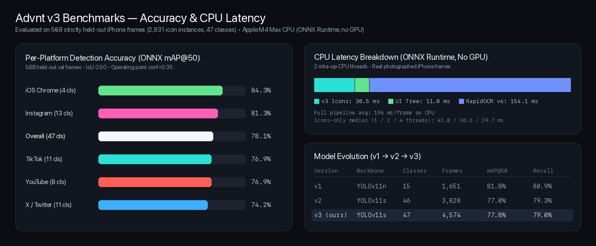

# Advnt Screen Parser (v3)

[](https://huggingface.co/arthuryeti/advnt-screen-parser)
[](https://www.python.org/downloads/)
[-005CED?style=flat-square)](https://onnxruntime.ai/)
[](LICENSE)
[](LICENSE-MODEL)

**CPU-fast iOS screen parser for mobile vision agents.** Combines a tiny **47-class YOLOv11s ONNX UI icon detector (~30 ms on CPU, no GPU)** with **RapidOCR (`PP-OCRv6-tiny`)** and a deterministic **geometric UI element tree** — turning raw screenshots or photographed iPhone screens into structured, tap-ready JSON in **~180–260 ms on CPU**.

Built in production for real iPhone automation across **Instagram, TikTok, X (Twitter), YouTube, and iOS system chrome** — trained on **4,574 real iPhone frames (24,145 icon boxes)** including camera-captured screens with glare, tilt, and thin icon strokes.


---

## Why This Exists

Multimodal LLMs are great at deciding *what* to tap on a phone screen, but bad at guessing raw pixel coordinates for tiny unlabelled icons (`♡`, `💬`, `↗`, `+`, `⋯`, `×`, `‹`) — especially when OCR returns only nearby numbers (`9,951`) and misses the icon itself.

**Advnt Screen Parser v3** gives any vision or text-only mobile agent a structured, numbered element list with exact bounding boxes and normalized coordinates (`boxPct`, `centerPct`, `where`):

1. **Advnt v3 Icon Detector (`icons.onnx`, 38 MB):** Fine-tuned YOLOv11s detecting **47 platform-specific iOS UI icons** in **~30.6 ms on CPU** (2 threads, ONNX Runtime).
2. **RapidOCR (`PP-OCRv6-tiny`):** Word-level OCR bounding boxes (~130–210 ms CPU).
3. **Geometric UI Tree (`uitree.py`):** Fuses learned icons + OCR words + adaptive glyph recovery + a **3-column profile grid slicer** (for Instagram/TikTok photo/drafts grids) into a reading-order, deduplicated UI element list (`<= 140` elements).

---

## Benchmarks



### Validation Accuracy (568 strictly held-out iPhone frames, 2,931 icon boxes)

All metrics below were measured directly on the exported **`icons.onnx`** (opset 17) over 568 temporally held-out validation frames (zero overlap with training or downstream eval suites):

| Platform | Classes | Val Boxes | ONNX mAP@50 | Precision (@0.35) | Recall (@0.35) |
| :--- | :---: | :---: | :---: | :---: | :---: |
| **iOS Chrome** | 4 | 333 | **84.3%** | 82.9% | 78.9% |
| **Instagram** | 13 | 863 | **81.3%** | 82.4% | 79.3% |
| **TikTok** | 11 | 689 | **76.9%** | 78.9% | 73.4% |
| **YouTube** | 8 | 391 | **76.9%** | 75.8% | 80.7% |
| **X / Twitter** | 11 | 655 | **74.2%** | 73.9% | 71.5% |
| **Overall (All 47 classes)** | **47** | **2,931** | **78.1%** | **78.4%** | **75.9%** |

*(Ultralytics PyTorch validation on `best.pt`: `mAP@50 = 77.8%`, `mAP@50-95 = 53.5%`, `Precision = 75.2%`, `Recall = 79.0%` — confirming zero degradation from ONNX export.)*

### Model Evolution (v1 → v2 → v3)

| Version | Backbone | Classes | Dataset (Train / Val) | Val mAP@50 | Val mAP@50–95 | Recall | Key Change |
| :---: | :---: | :---: | :---: | :---: | :---: | :---: | :--- |
| **v1** | YOLOv11n | 15 | 1,651 (1,438 / 213) | 81.8% | 54.1% | 80.9% | Cross-app merged icon labels |
| **v2** | YOLOv11s | 46 | 3,828 (3,338 / 490) | 77.0% | 52.3% | 79.3% | Split into platform-specific heads |
| **v3** | **YOLOv11s** | **47** | **4,574 (4,006 / 568)** | **77.8%** | **53.5%** | **79.0%** | Added per-platform `send`, boosted YouTube / share sheet / composer |

### CPU Latency (Apple M4 Max, ONNX Runtime CPUExecutionProvider, no GPU)

| Mode | Threads | Median | p95 | Notes |
| :--- | :---: | :---: | :---: | :--- |
| **Icon Detector only (`icons.onnx`)** | 1 | 41.0 ms | 45.6 ms | Zero GPU, 38 MB ONNX |
| **Icon Detector only (`icons.onnx`)** | 2 | **30.6 ms** | **31.4 ms** | Default production setting |
| **Icon Detector only (`icons.onnx`)** | 4 | 29.7 ms | 32.6 ms | Diminishing returns past 2 threads |
| **Full Pipeline (OCR + v3 Icons + UI Tree)** | 2 | **~185 ms** | **~260 ms** | `~130–210 ms` OCR + `~34 ms` icons + `~11 ms` UI tree |

### Downstream Mobile-Agent Impact

When deployed in our production mobile-agent loop alongside a local vision model (`Qwen3.8-27B`) on a frozen 72-frame benchmark:
- **Compose targeting accuracy:** `81.8%` → **`90.9%`** (+9.1 pp, matching/beating frontier API models)
- **Grounded `elementId` selection:** `53.8%` → **`63.2%`** (+9.4 pp)

---

## Quickstart

### Install

```bash
# Icon detector only (~30ms CPU, minimal dependencies)
pip install "git+https://github.com/arthuryeti/advnt-screen-parser.git"

# Full iOS Screen Parser (Icon detector + RapidOCR + UI tree + FastAPI server)
pip install "advnt-screen-parser[all] @ git+https://github.com/arthuryeti/advnt-screen-parser.git"
```

Weights (`icons.onnx` + `icons.json`) are downloaded automatically on first run from [Hugging Face (`arthuryeti/advnt-screen-parser`)](https://huggingface.co/arthuryeti/advnt-screen-parser) and cached locally.

### 1. Icon Detection Only (~30 ms CPU)

```python
from advnt_screen_parser import IconDetector

detector = IconDetector()  # auto-downloads icons.onnx from Hugging Face
icons = detector.detect_file("assets/examples/instagram_feed.jpg")

for icon in icons:
    print(f"{icon['label']:16s} conf={icon['confidence']:.2f} center={icon['centerPct']}")
```

### 2. Full Screen Parse (Icons + OCR + UI Tree)

```python
from advnt_screen_parser import ScreenParser

parser = ScreenParser()
result = parser.parse_file("assets/examples/instagram_feed.jpg")

print(f"Parsed in {result['totalMs']} ms ({len(result['icons'])} icons, {len(result['elements'])} elements)")
for el in result["elements"][:10]:
    print(f"[{el['id']:2d}] {el['role']:6s} {el['label']!r:20s} @ {el['centerPct']} ({el['where']})")
```

### 3. CLI

```bash
# Full parse + save annotated visualization
advnt-parse assets/examples/tiktok_feed.jpg --viz out.png --out result.json

# Fast icon-only mode (~30 ms CPU)
advnt-parse assets/examples/tiktok_feed.jpg --icons-only
```

### 4. Docker HTTP Microservice

```bash
docker build -t advnt-screen-parser .
docker run -p 8000:8000 advnt-screen-parser

curl -X POST http://localhost:8000/v1/parse \
  -H "Content-Type: image/jpeg" \
  --data-binary @assets/examples/instagram_feed.jpg
```

Set `ADVNT_API_TOKEN` to require `Authorization: Bearer <token>` in production.

---

## Example Output

Full sample output is included in [assets/examples/sample_output.json](assets/examples/sample_output.json):

```json
{
  "ocrModel": "PP-OCRv6-tiny",
  "iconModel": "advnt-icons-v3-yolo11s",
  "width": 461,
  "height": 1015,
  "ocrMs": 134.4,
  "iconsMs": 33.2,
  "uitreeMs": 12.3,
  "totalMs": 179.9,
  "icons": [
    { "label": "ig_repost", "confidence": 0.861, "box": [397, 598, 443, 636], "centerPct": [91.1, 60.8] },
    { "label": "ig_search", "confidence": 0.834, "box": [308, 912, 343, 949], "centerPct": [70.6, 91.7] },
    { "label": "ig_profile_tab", "confidence": 0.824, "box": [394, 912, 439, 949], "centerPct": [90.3, 91.7] },
    { "label": "ig_like", "confidence": 0.823, "box": [401, 472, 446, 510], "centerPct": [91.9, 48.4] },
    { "label": "ig_home_tab", "confidence": 0.818, "box": [24, 911, 67, 949], "centerPct": [9.9, 91.6] }
  ],
  "elements": [
    { "id": 15, "role": "icon", "label": "like", "boxPct": [87.0, 46.5, 96.7, 50.2], "centerPct": [91.9, 48.4], "where": "middle right" },
    { "id": 16, "role": "text", "label": "9,951", "boxPct": [87.6, 50.9, 96.1, 52.7], "centerPct": [91.9, 51.8], "where": "middle right" }
  ]
}
```

---

## Supported 47 UI Icon Classes

| Platform | Count | Classes |
| :--- | :---: | :--- |
| **Instagram** | 13 | `ig_like`, `ig_comment`, `ig_share`, `ig_save`, `ig_repost`, `ig_more`, `ig_home_tab`, `ig_reels_tab`, `ig_profile_tab`, `ig_search`, `ig_create`, `ig_menu`, `ig_send` |
| **TikTok** | 11 | `tt_like`, `tt_comment`, `tt_share`, `tt_save`, `tt_home_tab`, `tt_profile_tab`, `tt_create`, `tt_search`, `tt_friends_tab`, `tt_inbox_tab`, `tt_send` |
| **X / Twitter** | 11 | `x_like`, `x_comment`, `x_repost`, `x_save`, `x_share`, `x_compose`, `x_home_tab`, `x_profile_tab`, `x_more`, `x_media`, `x_send` |
| **YouTube** | 8 | `yt_like`, `yt_comment`, `yt_share`, `yt_more`, `yt_reels_tab`, `yt_home_tab`, `yt_profile_tab`, `yt_create` |
| **iOS Chrome** | 4 | `ios_back`, `ios_close`, `ios_clear_search`, `ios_copy_link` |

In `uitree.py`, platform prefixes are normalized to canonical semantic labels (e.g. `ig_like` → `like`, `x_media` → `media_upload`), overlapping heuristic icon blobs are suppressed, and unlabelled fallback icons are explicitly tagged `near "<adjacent text>"` so downstream agents never confuse heuristic guesses with learned icon detections.

---

## Training & Reproducing Benchmarks

Training hyperparameters used for v3 (`scripts/train_icons.py`):
- **Base model:** `yolo11s.pt` (`imgsz=640`, `batch=32`, 30 epochs best @ ep 29 on Apple M4 Max MPS in 53.5 min)
- **Augmentations:** `fliplr=0.0`, `flipud=0.0` (UI icons are orientation- and side-sensitive!), `degrees=3.0`, `translate=0.08`, `scale=0.18`, `hsv_s/v=0.35`, `mosaic=0.3`, `close_mosaic=8`
- **Export:** ONNX `opset=17`, `simplify=True`, static `1x3x640x640`

Reproduce CPU latency locally:

```bash
python scripts/benchmark.py --images "assets/examples/*.jpg"
```

---

## Limitations

- **iOS social apps focus:** Trained specifically on iOS Instagram, TikTok, X, YouTube, and iOS system chrome. General desktop/Android icons fall back to the CV heuristic pass in `uitree.py`.
- **Small / rare classes:** `ig_send` (`47.3%` AP@50 on val) and `x_more` (`62.9%` AP@50) have lower recall than primary rail/tab icons (`80–96%` AP@50).
- **App UI updates:** Major redesigns by Instagram/TikTok/X/YouTube can shift icon silhouettes over time; fine-tuning with `scripts/train_icons.py` on a few hundred updated frames restores accuracy quickly.

---

## Credits & Licensing

- **Code (`src/`, `scripts/`, `tests/`):** Released under the **[MIT License](LICENSE)**.
- **UI Tree Heuristics:** `src/advnt_screen_parser/uitree.py` is adapted from [esp32-iphone-agent](https://github.com/onehumanbeing/esp32-iphone-agent) by Henry Yuan (MIT License).
- **Model Weights (`icons.onnx`, `best.pt`):** Fine-tuned from Ultralytics YOLOv11s and released under **[GNU AGPL-3.0](LICENSE-MODEL)**.
