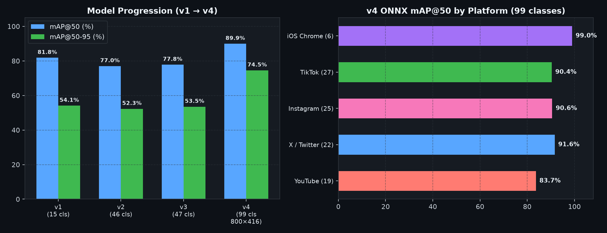

# Advnt Screen Parser (v4)

[](https://huggingface.co/arthuryeti/advnt-screen-parser)
[](https://www.python.org/downloads/)
[-005CED?style=flat-square)](https://onnxruntime.ai/)
[](LICENSE)
[](LICENSE-MODEL)

**CPU-fast iOS screen parser for mobile vision agents.** Combines a **99-class portrait (`800×416`) YOLOv11s ONNX UI icon detector (~24 ms on CPU, no GPU)** with **RapidOCR (`PP-OCRv6-tiny`)** and a deterministic **geometric UI element tree** — turning raw screenshots or photographed iPhone screens into structured, tap-ready JSON in **~160–240 ms on CPU**.

Built in production for real iPhone automation across **Instagram, TikTok, X (Twitter), YouTube, and iOS system chrome** — trained on **5,268 teacher-relabeled real iPhone frames (40,330 tight icon boxes)** including complete bottom tab bars, app-specific back chevrons/arrows, top-left/top-right corner chrome, active engagement states (`*_liked` / `*_saved`), profile sub-tabs, account switchers, and iOS Home Screen app icons.


---

## Why This Exists

Multimodal LLMs are great at deciding *what* to tap on a phone screen, but bad at guessing raw pixel coordinates for tiny unlabelled icons (`♡`, `💬`, `↗`, `+`, `⋯`, `×`, `‹`, `☰`, `⌄`) — especially when OCR returns only nearby numbers (`9,951`) and misses the icon itself.

**Advnt Screen Parser v4** gives any vision or text-only mobile agent a structured, numbered element list with exact bounding boxes and normalized coordinates (`boxPct`, `centerPct`, `where`):

1. **Advnt v4 Icon Detector (`icons.onnx`, 38.0 MB):** Fine-tuned YOLOv11s exported at portrait **`800×416`** detecting **99 platform-specific iOS UI icons** (including filled `*_liked` and `*_saved` states) in **23.9 ms median on CPU** (2 threads, ONNX Runtime) — **22% faster** and **+25% sharper linear resolution** than square `640×640`.
2. **RapidOCR (`PP-OCRv6-tiny`):** Word-level OCR bounding boxes (~120–200 ms CPU).
3. **Geometric UI Tree (`uitree.py`):** Fuses learned icons + OCR words + adaptive glyph recovery + a **3-column profile grid slicer** (for Instagram/TikTok photo/drafts grids) into a reading-order, deduplicated UI element list (`<= 140` elements).

---

## Benchmarks



### Validation Accuracy (596 strictly held-out iPhone frames, 4,700 icon boxes)

All metrics below were measured directly on the exported portrait **`icons.onnx`** (`1×3×800×416`, opset 17) over 596 temporally & job-grouped held-out validation frames (zero overlap with training or downstream eval suites):

| Platform | Classes | Val Boxes | ONNX mAP@50 | Precision (@0.35) | Recall (@0.35) |
| :--- | :---: | :---: | :---: | :---: | :---: |
| **iOS Chrome & App Icons** | 6 | 187 | **99.0%** | 94.4% | 98.9% |
| **X / Twitter** | 22 | 1,205 | **91.6%** | 90.7% | 93.9% |
| **Instagram** | 25 | 1,076 | **90.6%** | 86.1% | 92.9% |
| **TikTok** | 27 | 1,657 | **90.4%** | 91.8% | 96.1% |
| **YouTube** | 19 | 575 | **83.7%** | 92.1% | 80.9% |
| **Overall (All 99 classes)** | **99** | **4,700** | **89.9%** | **90.3%** | **93.0%** |

*(Ultralytics PyTorch validation on `best.pt`: `mAP@50 = 90.3%`, `mAP@50-95 = 75.1%`; ONNX `[800, 416]` validation: `mAP@50 = 89.9%`, `mAP@50-95 = 74.5%`, `Precision = 85.3%`, `Recall = 89.7%`.)*

### Model Evolution (v1 → v2 → v3 → v4)

| Version | Backbone | Input | Classes | Dataset (Train / Val) | Val mAP@50 | Val mAP@50–95 | Recall | Key Change |
| :---: | :---: | :---: | :---: | :---: | :---: | :---: | :---: | :--- |
| **v1** | YOLOv11n | `640×640` | 15 | 1,651 (1,438 / 213) | 81.8% | 54.1% | 80.9% | Cross-app merged icon labels |
| **v2** | YOLOv11s | `640×640` | 46 | 3,828 (3,338 / 490) | 77.0% | 52.3% | 79.3% | Split into platform-specific heads |
| **v3** | YOLOv11s | `640×640` | 47 | 4,574 (4,006 / 568) | 77.8% | 53.5% | 79.0% | Added per-platform `send`, boosted YT / share sheet |
| **v4** | **YOLOv11s** | **`800×416`** | **99** | **5,268 (4,672 / 596)** | **89.9%** | **74.5%** | **89.7%** | Full teacher relabeling pass, portrait input, complete tab bars, `*_liked`/`*_saved`, app-specific back/corner icons & iOS app icons |

### CPU Latency (Apple M4 Max, ONNX Runtime CPUExecutionProvider, no GPU)

| Mode | Threads | Median | p95 | Notes |
| :--- | :---: | :---: | :---: | :--- |
| **Icon Detector only (`icons.onnx`, `800×416`)** | 1 | 32.2 ms | 37.6 ms | Zero GPU, 38.0 MB ONNX |
| **Icon Detector only (`icons.onnx`, `800×416`)** | 2 | **23.9 ms** | **24.5 ms** | Default production setting (22% faster than v3) |
| **Icon Detector only (`icons.onnx`, `800×416`)** | 4 | 22.4 ms | 23.3 ms | Diminishing returns past 2 threads |
| **Full Pipeline (OCR + v4 Icons + UI Tree)** | 2 | **~180 ms** | **~240 ms** | `~120–200 ms` OCR + `~24 ms` icons + `~10 ms` UI tree |

---

## Quickstart

### Install

```bash
# Icon detector only (~24ms CPU, minimal dependencies)
pip install "git+https://github.com/arthuryeti/advnt-screen-parser.git"

# Full iOS Screen Parser (Icon detector + RapidOCR + UI tree + FastAPI server)
pip install "advnt-screen-parser[all] @ git+https://github.com/arthuryeti/advnt-screen-parser.git"
```

Weights (`icons.onnx` + `icons.json`) are downloaded automatically on first run from [Hugging Face (`arthuryeti/advnt-screen-parser`)](https://huggingface.co/arthuryeti/advnt-screen-parser) and cached locally.

### 1. Icon Detection Only (~24 ms CPU)

```python
from advnt_screen_parser import IconDetector

detector = IconDetector()  # auto-downloads icons.onnx from Hugging Face
icons = detector.detect_file("assets/examples/tiktok_feed.jpg")

for icon in icons:
    print(f"{icon['label']:20s} conf={icon['confidence']:.2f} center={icon['centerPct']}")
```

### 2. Full Screen Parse (Icons + OCR + UI Tree)

```python
from advnt_screen_parser import ScreenParser

parser = ScreenParser()
result = parser.parse_file("assets/examples/instagram_feed.jpg")

print(f"Parsed in {result['totalMs']} ms ({len(result['icons'])} icons, {len(result['elements'])} elements)")
for el in result["elements"][:10]:
    print(f"[{el['id']:2d}] {el['role']:6s} {el['label']!r:20s} @ {el['centerPct']} ({el['where']})")
```

### 3. CLI

```bash
# Full parse + save annotated visualization
advnt-parse assets/examples/tiktok_feed.jpg --viz out.png --out result.json

# Fast icon-only mode (~24 ms CPU)
advnt-parse assets/examples/tiktok_feed.jpg --icons-only
```

### 4. Docker HTTP Microservice

```bash
docker build -t advnt-screen-parser .
docker run -p 8000:8000 advnt-screen-parser

curl -X POST http://localhost:8000/v1/parse \
  -H "Content-Type: image/jpeg" \
  --data-binary @assets/examples/instagram_feed.jpg
```

Set `ADVNT_API_TOKEN` to require `Authorization: Bearer <token>` in production.

---

## Supported 99 UI Icon Classes

| Platform | Count | Classes |
| :--- | :---: | :--- |
| **Instagram** | 25 | `ig_like`, `ig_liked`, `ig_comment`, `ig_repost`, `ig_share`, `ig_save`, `ig_saved`, `ig_more`, `ig_avatar`, `ig_audio`, `ig_home_tab`, `ig_reels_tab`, `ig_messages_tab`, `ig_search_tab`, `ig_profile_tab`, `ig_back`, `ig_create`, `ig_menu`, `ig_notifications`, `ig_threads`, `ig_account_switcher`, `ig_grid_tab`, `ig_reels_subtab`, `ig_tagged_tab`, `ig_send` |
| **TikTok** | 27 | `tt_like`, `tt_liked`, `tt_comment`, `tt_save`, `tt_saved`, `tt_share`, `tt_avatar`, `tt_follow`, `tt_sound`, `tt_repost`, `tt_home_tab`, `tt_friends_tab`, `tt_create`, `tt_inbox_tab`, `tt_profile_tab`, `tt_back`, `tt_live`, `tt_search`, `tt_menu`, `tt_more`, `tt_add_friend`, `tt_account_switcher`, `tt_videos_tab`, `tt_repost_tab`, `tt_liked_tab`, `tt_send`, `tt_gallery` |
| **X / Twitter** | 22 | `x_like`, `x_liked`, `x_comment`, `x_repost`, `x_save`, `x_saved`, `x_share`, `x_views`, `x_more`, `x_avatar`, `x_grok`, `x_home_tab`, `x_search_tab`, `x_grok_tab`, `x_notifications_tab`, `x_messages_tab`, `x_profile_tab`, `x_compose`, `x_back`, `x_account_switcher`, `x_media`, `x_send` |
| **YouTube** | 19 | `yt_like`, `yt_liked`, `yt_dislike`, `yt_comment`, `yt_share`, `yt_save`, `yt_saved`, `yt_remix`, `yt_avatar`, `yt_sound`, `yt_home_tab`, `yt_reels_tab`, `yt_create`, `yt_subscriptions_tab`, `yt_profile_tab`, `yt_back`, `yt_search`, `yt_more`, `yt_cast` |
| **iOS Chrome & App Icons** | 6 | `ios_close`, `ios_clear_search`, `ios_app_tiktok`, `ios_app_instagram`, `ios_app_x`, `ios_app_youtube` |

In `uitree.py`, platform prefixes are normalized to canonical semantic labels (e.g. `tt_liked` → `liked`, `ig_messages_tab` → `messages_tab`, `x_media` → `media_upload`, `ios_app_tiktok` → `app_result:tiktok`), overlapping heuristic icon blobs are suppressed, and unlabelled fallback icons are explicitly tagged `near "<adjacent text>"`.

---

## Training & Reproducing Benchmarks

Training hyperparameters used for v4 (`scripts/train_icons.py`):
- **Base model:** `yolo11s.pt` (trained at `imgsz=800`, `batch=24`, 45 epochs on Apple M4 Max MPS)
- **Augmentations:** `fliplr=0.0`, `flipud=0.0`, `degrees=2.5`, `translate=0.08`, `scale=0.18`, `hsv_h=0.008` (tight hue jitter preserves red/yellow/blue active states), `hsv_s=0.25`, `hsv_v=0.35`, `mosaic=0.3`, `close_mosaic=10`
- **Export:** Portrait ONNX `opset=17`, `simplify=True`, static **`1×3×800×416`**

Reproduce CPU latency locally:

```bash
python scripts/benchmark.py --images "assets/examples/*.jpg"
```

---

## Credits & Licensing

- **Code (`src/`, `scripts/`, `tests/`):** Released under the **[MIT License](LICENSE)**.
- **UI Tree Heuristics:** `src/advnt_screen_parser/uitree.py` is adapted from [esp32-iphone-agent](https://github.com/onehumanbeing/esp32-iphone-agent) by Henry Yuan (MIT License).
- **Model Weights (`icons.onnx`, `best.pt`):** Fine-tuned from Ultralytics YOLOv11s and released under **[GNU AGPL-3.0](LICENSE-MODEL)**.
