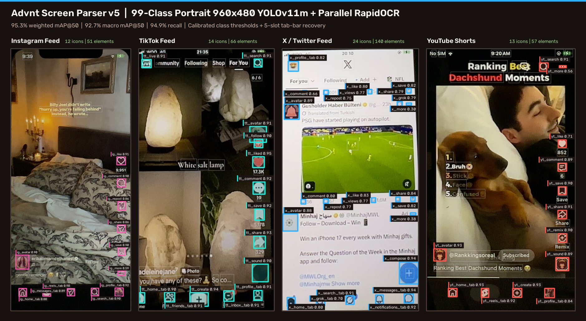
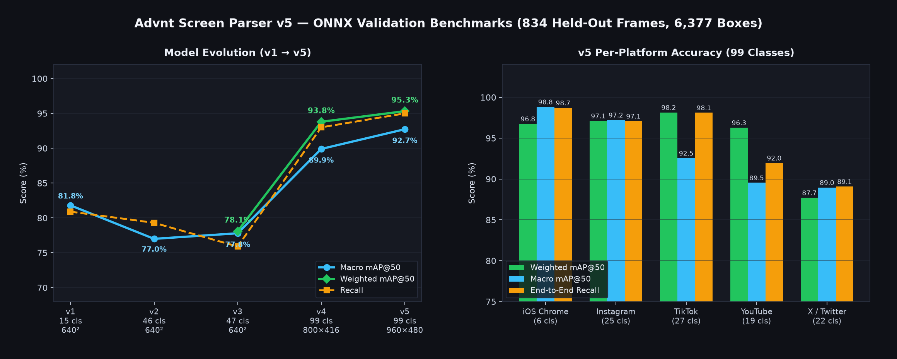

# Advnt Screen Parser (v5)

[](https://huggingface.co/arthuryeti/advnt-screen-parser)
[](https://www.python.org/downloads/)
[-005CED?style=flat-square)](https://onnxruntime.ai/)
[](LICENSE)
[](LICENSE-MODEL)

**CPU-fast iOS screen parser for mobile vision agents.** Combines a **99-class portrait (`960×480`) YOLOv11m ONNX UI icon detector (`95.3%` weighted / `92.7%` macro mAP@50, `94.9%` end-to-end recall)** with **parallel RapidOCR (`PP-OCRv6-tiny`)** and a deterministic **geometric UI element tree** — turning raw screenshots or photographed iPhone screens into structured, tap-ready JSON on CPU with zero GPU.

Built in production for real iPhone automation across **Instagram, TikTok, X (Twitter), YouTube, and iOS system chrome** — trained on **7,357 app-verified, frontier-audited real iPhone frames (53,983 tight icon boxes + 643 non-social hard negatives)** with per-class F1 threshold calibration, cross-app consistency voting, and 5-slot bottom tab-bar recovery.



---

## Why This Exists

Multimodal LLMs are great at deciding *what* to tap on a phone screen, but bad at guessing raw pixel coordinates for tiny unlabelled icons (`♡`, `💬`, `↗`, `+`, `⋯`, `×`, `‹`, `☰`, `⌄`) — especially when OCR returns only nearby numbers (`9,951`) and misses the icon itself.

**Advnt Screen Parser v5** gives any vision or text-only mobile agent a structured, numbered element list with exact bounding boxes and normalized coordinates (`boxPct`, `centerPct`, `where`):

1. **Advnt v5 Icon Detector (`icons.onnx`, 80.7 MB):** Two-stage portrait-fine-tuned YOLOv11m (`1×3×960×480`, opset 17) detecting **99 platform-specific iOS UI icons** (including filled `*_liked` and `*_saved` states) with per-class calibrated thresholds, cross-app consistency voting, and 5-slot bottom tab-bar recovery.
2. **Parallel RapidOCR (`PP-OCRv6-tiny`):** Runs concurrently with `IconDetector` on a worker thread so icon detection hides behind OCR latency.
3. **Geometric UI Tree (`uitree.py`):** Fuses learned icons + OCR words + adaptive glyph recovery + a **3-column profile grid slicer** (for Instagram/TikTok photo/drafts grids) into a reading-order, deduplicated UI element list (`<= 140` elements).

---

## Benchmarks



### Validation Accuracy (834 strictly held-out iPhone frames, 6,377 icon boxes + 46 hard negatives)

All metrics below were measured directly on the exported portrait **`icons.onnx`** (`1×3×960×480`, opset 17) over 834 temporally & job-grouped held-out validation frames (zero overlap with training or downstream eval suites):

| Platform | Classes | Val Boxes | Macro mAP@50 | Weighted mAP@50 | End-to-End Precision | End-to-End Recall |
| :--- | :---: | :---: | :---: | :---: | :---: | :---: |
| **iOS Chrome & App Icons** | 6 | 232 | **98.8%** | **96.8%** | 91.2% | **98.3%** |
| **Instagram** | 25 | 1,745 | **97.2%** | **97.1%** | 94.7% | **97.0%** |
| **TikTok** | 27 | 2,075 | **92.6%** | **98.2%** | 95.3% | **98.1%** |
| **YouTube** | 19 | 970 | **89.5%** | **96.3%** | 95.3% | **92.0%** |
| **X / Twitter** | 22 | 1,355 | **89.0%** | **87.7%** | 83.9% | **89.0%** |
| **Overall (All 99 classes)** | **99** | **6,377** | **92.7%** | **95.3%** | **92.5%** | **94.9%** |

### Model Evolution (v1 → v2 → v3 → v4 → v5)

| Version | Backbone | Input | Classes | Dataset (Train / Val) | Macro mAP@50 | Weighted mAP@50 | Recall | Key Change |
| :---: | :---: | :---: | :---: | :---: | :---: | :---: | :---: | :--- |
| **v1** | YOLOv11n | `640×640` | 15 | 1,651 (1,438 / 213) | 81.8% | — | 80.9% | Cross-app merged icon labels |
| **v2** | YOLOv11s | `640×640` | 46 | 3,828 (3,338 / 490) | 77.0% | — | 79.3% | Split into platform-specific heads |
| **v3** | YOLOv11s | `640×640` | 47 | 4,574 (4,006 / 568) | 77.8% | ~78.1% | 75.9% | Added per-platform `send`, boosted YT / share sheet |
| **v4** | YOLOv11s | `800×416` | 99 | 5,268 (4,672 / 596) | 89.9% | 93.8% | 93.0% | Teacher relabeling, portrait input, complete tab bars, `*_liked`/`*_saved` |
| **v5** | **YOLOv11m** | **`960×480`** | **99** | **7,357 (6,523 / 834)** | **92.7%** | **95.3%** | **94.9%** | Frontier disagreement audit, app-verified mining, hard negatives, two-stage portrait fine-tuning, per-class thresholds, app voting & tab-bar slot recovery |

---

## Quickstart

### Install

```bash
# Icon detector only (CPU ONNX, minimal dependencies)
pip install "git+https://github.com/arthuryeti/advnt-screen-parser.git"

# Full iOS Screen Parser (Parallel RapidOCR + v5 Icon detector + UI tree + FastAPI server)
pip install "advnt-screen-parser[all] @ git+https://github.com/arthuryeti/advnt-screen-parser.git"
```

Weights (`icons.onnx` + `icons.json`) are downloaded automatically on first run from [Hugging Face (`arthuryeti/advnt-screen-parser`)](https://huggingface.co/arthuryeti/advnt-screen-parser) and cached locally.

### 1. Icon Detection Only

```python
from advnt_screen_parser import IconDetector

detector = IconDetector()  # auto-downloads v5 icons.onnx + calibrated icons.json from Hugging Face
icons = detector.detect_file("assets/examples/tiktok_feed.jpg")

for icon in icons:
    print(f"{icon['label']:20s} conf={icon['confidence']:.2f} center={icon['centerPct']}")
```

### 2. Full Screen Parse (Parallel OCR + Icons + UI Tree)

```python
from advnt_screen_parser import ScreenParser

parser = ScreenParser()
result = parser.parse_file("assets/examples/instagram_feed.jpg")

print(f"Parsed in {result['totalMs']} ms ({len(result['icons'])} icons, {len(result['elements'])} elements)")
for el in result["elements"][:10]:
    print(f"[{el['id']:2d}] {el['role']:6s} {el['label']!r:20s} @ {el['centerPct']} ({el['where']})")
```

### 3. CLI & Docker

```bash
advnt-parse assets/examples/tiktok_feed.jpg --viz out.png --out result.json
advnt-parse assets/examples/tiktok_feed.jpg --icons-only
```

```bash
docker build -t advnt-screen-parser .
docker run -p 8000:8000 advnt-screen-parser
```

---

## Supported 99 UI Icon Classes

| Platform | Count | Classes |
| :--- | :---: | :--- |
| **Instagram** | 25 | `ig_like`, `ig_liked`, `ig_comment`, `ig_repost`, `ig_share`, `ig_save`, `ig_saved`, `ig_more`, `ig_avatar`, `ig_audio`, `ig_home_tab`, `ig_reels_tab`, `ig_messages_tab`, `ig_search_tab`, `ig_profile_tab`, `ig_back`, `ig_create`, `ig_menu`, `ig_notifications`, `ig_threads`, `ig_account_switcher`, `ig_grid_tab`, `ig_reels_subtab`, `ig_tagged_tab`, `ig_send` |
| **TikTok** | 27 | `tt_like`, `tt_liked`, `tt_comment`, `tt_save`, `tt_saved`, `tt_share`, `tt_avatar`, `tt_follow`, `tt_sound`, `tt_repost`, `tt_home_tab`, `tt_friends_tab`, `tt_create`, `tt_inbox_tab`, `tt_profile_tab`, `tt_back`, `tt_live`, `tt_search`, `tt_menu`, `tt_more`, `tt_add_friend`, `tt_account_switcher`, `tt_videos_tab`, `tt_repost_tab`, `tt_liked_tab`, `tt_send`, `tt_gallery` |
| **X / Twitter** | 22 | `x_like`, `x_liked`, `x_comment`, `x_repost`, `x_save`, `x_saved`, `x_share`, `x_views`, `x_more`, `x_avatar`, `x_grok`, `x_home_tab`, `x_search_tab`, `x_grok_tab`, `x_notifications_tab`, `x_messages_tab`, `x_profile_tab`, `x_compose`, `x_back`, `x_account_switcher`, `x_media`, `x_send` |
| **YouTube** | 19 | `yt_like`, `yt_liked`, `yt_dislike`, `yt_comment`, `yt_share`, `yt_save`, `yt_saved`, `yt_remix`, `yt_avatar`, `yt_sound`, `yt_home_tab`, `yt_reels_tab`, `yt_create`, `yt_subscriptions_tab`, `yt_profile_tab`, `yt_back`, `yt_search`, `yt_more`, `yt_cast` |
| **iOS Chrome & App Icons** | 6 | `ios_close`, `ios_clear_search`, `ios_app_tiktok`, `ios_app_instagram`, `ios_app_x`, `ios_app_youtube` |

---

## Credits & Licensing

- **Code (`src/`, `scripts/`, `tests/`):** Released under the **[MIT License](LICENSE)**.
- **UI Tree Heuristics:** `src/advnt_screen_parser/uitree.py` is adapted from [esp32-iphone-agent](https://github.com/onehumanbeing/esp32-iphone-agent) by Henry Yuan (MIT License).
- **Model Weights (`icons.onnx`, `best.pt`):** Fine-tuned from Ultralytics YOLOv11m and released under **[GNU AGPL-3.0](LICENSE-MODEL)**.
